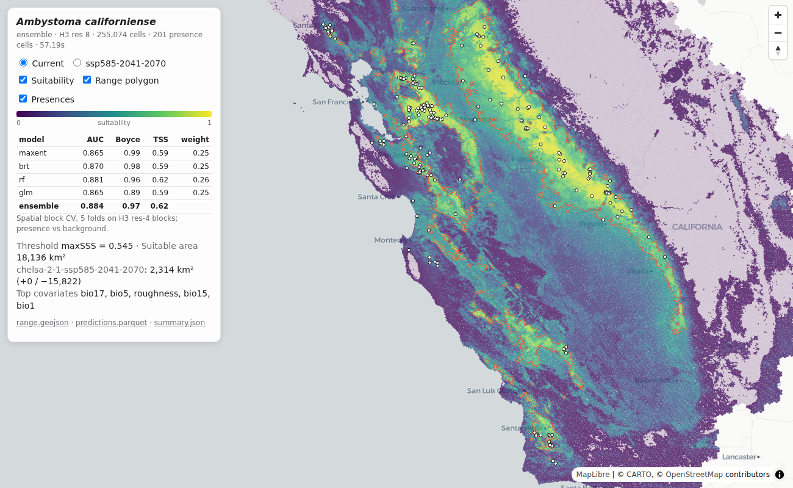

# hexsdm: species distribution models over MCP

hexsdm is an MCP server that fits species distribution models (SDMs) on request. It takes occurrence records, by default from GBIF, and relates them to climate, terrain, land cover and human modification layers from the [boettiger-lab STAC catalog](https://s3-west.nrp-nautilus.io/public-data/stac/catalog.json). It returns a habitat suitability surface on the H3 grid, a modelled range, cross-validated performance, and optionally a projection under future climate.

The public server is at `https://sdm-mcp.nrp-nautilus.io/mcp`. Any MCP client can use it, including [geo-agent](https://boettiger-lab.github.io/geo-agent/) map apps and Claude Code.



## How a model is built

Every step works on H3 cells. All input layers are already indexed at H3 resolution 8, so building the model matrix is a set of DuckDB joins over parquet on S3, with no raster processing.

1. **Occurrences.** GBIF records (2026-09 snapshot, quality-filtered, isolated outliers removed) or the user's own points are reduced to one presence per occupied cell.
2. **Study area.** The default is a 100 km buffer around the records. A region, country or bounding box can be given instead.
3. **Resolution.** The model uses the finest H3 resolution from 5 to 8 that keeps the study area under 2 million cells.
4. **Covariates.** 18 predictors are read for every cell in the study area: 7 CHELSA climate variables, elevation and roughness, 8 land-cover fractions and the Global Human Modification index. See [Data layers](data-layers.md).
5. **Background.** 20,000 cells are sampled from the study area, either uniformly or in proportion to GBIF sampling effort for the species' taxonomic class.
6. **Models.** A down-sampled random forest and a GLM are fit by default; MaxEnt, boosted regression trees, GAM, BIOCLIM and Mahalanobis distance can be requested. Each is evaluated by spatial block cross-validation, and they are combined into an ensemble weighted by cross-validated AUC. See [Algorithms](algorithms.md).
7. **Range.** Suitability is thresholded (maxSSS by default) into a binary range.
8. **Projection.** Optionally, the fitted models are re-run with future CHELSA climate, holding the other layers at present-day values.

## Pages

- [Data layers](data-layers.md): which datasets go into a model, and which of them you can change.
- [Using fit_sdm](usage.md): all parameters, the polling pattern, and the outputs.
- [Algorithms](algorithms.md): the methods, their literature and implementations.
- [Benchmarks](benchmarks.md): speed, agreement with R reference implementations, and validation.

## Connecting a client

Claude Code:

```bash
claude mcp add --transport http hex-sdm https://sdm-mcp.nrp-nautilus.io/mcp
```

geo-agent apps list the server as an optional second MCP endpoint in `layers-input.json`:

```json
"mcp_servers": [
  { "url": "https://duckdb-mcp.nrp-nautilus.io/mcp" },
  { "url": "https://sdm-mcp.nrp-nautilus.io/mcp", "optional": true }
]
```

To run the server locally, see the [README](https://github.com/boettiger-lab/glen-sdm#running).

## Interpreting results

Suitability is relative habitat suitability estimated from presence-only data. Cross-validated AUC, TSS and Boyce index compare presences with background cells, not with surveyed absences. The modelled range is a potential distribution under the chosen covariates and threshold, not a confirmed distribution.
